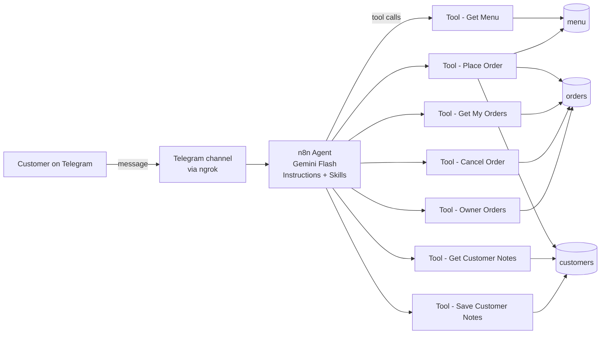

# 🥐 Bakeshop AI Order Assistant (n8n Agent + Telegram)

A customer-service AI agent for a small home bakery. Customers chat with it on **Telegram** to browse the menu, place and change orders, and ask about store hours. It answers in **English, Filipino, or Taglish**, remembers returning customers' preferences and allergies, and lets the owner pull up new orders with an owner-only check.

Built with **n8n's Agents feature**, **Gemini**, **n8n Data Tables**, and **JavaScript Code nodes**. Self-hosted and exposed to Telegram through **ngrok**.

> **Key design rule:** the LLM handles the conversation, and **code handles anything that must always be correct**: prices, totals, dates, saving data, and access checks.

---

## ✨ Features

| Feature | How it works |
|---|---|
| **Menu & prices** | Read live from a `menu` Data Table. Unavailable items are filtered out in the workflow, so the AI never sees them. |
| **Ordering (quote → confirm)** | The agent first gets an exact quote (`confirm=false`), shows it, and saves only after a clear "yes" (`confirm=true`). |
| **Totals calculated in code** | A Code node validates items against the menu and computes the total. The LLM never does the math. |
| **Pickup date rules** | Code enforces a 1-day lead time, **closed on Mondays**, and 09:00–18:00 hours, using **Asia/Manila** time. It suggests the next valid date. |
| **Customer memory** | Notes such as allergies and favorite items are stored per contact number and recalled in future chats. |
| **Order lookup** | "Can I see my orders?" is answered from the database, never from the chat history. |
| **Cancel / merge orders** | A soft-delete cancel tool sets `status = cancelled` (history is kept) and only works on the customer's own orders. |
| **Owner mode** | The owner sends a secret code and gets "Good morning/afternoon/evening, boss. Here are the new orders". The code is checked **in a Code node, never in the prompt**. |
| **Stays on topic** | It declines unrelated requests, such as song lyrics or sports news. |

---

## 🏗️ Architecture

### Agent
- **Instructions** (always loaded): persona, language, privacy rules, and store facts. See [`agent/instructions.md`](agent/instructions.md).
- **Skills** (loaded only when relevant):
  - [`Take an order`](agent/skills/take-an-order.md): an 8-step ordering playbook with all 6 order tools.
  - [`Answer customer questions`](agent/skills/answer-customer-questions.md): menu questions, with `Tool get menu` only (least privilege).

### Tool workflows (`/workflows`)

| Workflow | Purpose | Key safeguards |
|---|---|---|
| `Tool - Get Menu` | Available products and prices | Filters `available = true` in the workflow |
| `Tool - Place Order` | Quote or save an order | Validates items, quantity, and date; looks up the saved customer name; saves only if `ok AND confirm` |
| `Tool - Get Customer Notes` | Look up a returning customer | Rejects an empty contact instead of returning "not found" |
| `Tool - Save Customer Notes` | Upsert name and notes | Validates contact and name before writing; matches on contact |
| `Tool - Get My Orders` | List the customer's active orders | Filters by exact contact; hides cancelled orders |
| `Tool - Cancel Order` | Soft-delete an order | Matches on `id` **and** `contact`; updates only `status` |
| `Tool - Owner Orders` | Owner view of all new orders | Secret checked in code; the orders table isn't read unless the check passes |

### Data model (n8n Data Tables)

| Table | Columns |
|---|---|
| `menu` | `item` (string), `price` (number), `available` (boolean), `description` (string) |
| `orders` | `customer_name`, `contact`, `items`, `total` (number), `pickup_date`, `status` (`new` / `cancelled`) |
| `customers` | `contact` (unique key, string, keeps the leading 0), `name`, `notes` |

---

## 🧠 Engineering decisions

1. **The LLM never does the math.** Totals come from `price × qty` in a Code node. LLMs are unreliable with arithmetic and calendars, so they get the result instead of doing the calculation.
2. **Quote first, then confirm.** `confirm=false` returns an exact total without saving. The IF node saves only when the order is valid **and** confirmed, so even a premature "confirm" can't save an invalid order.
3. **"No order ID means not saved."** Every confirmation must include the order ID returned by the tool, which makes false confirmations easy to spot.
4. **Dates are validated in code.** The model converts "bukas" or "Saturday" to `YYYY-MM-DD`, and Luxon (`Asia/Manila`) decides whether that date is allowed.
5. **Soft deletes.** Cancelling changes a status instead of deleting the row, so order history is kept.
6. **Secrets stay out of prompts.** The owner code lives only in a Code node. The model passes along what the user typed and never knows the real value.
7. **Least privilege for skills.** The Q&A skill can only read the menu. It can't place orders or read customer notes.
8. **Error messages steer the agent.** Every `ok:false` explains how to fix the call (for example, the exact JSON format to use), so the agent can recover by itself.

---

## 🐛 Debugging story: what broke and how I fixed it

Testing with a lightweight model (Gemini Flash-Lite) exposed real agent failure modes. I traced each one through **tool-call inputs and outputs, n8n execution logs, and the Data Tables**:

| Symptom | Root cause | Fix |
|---|---|---|
| Asked for the name again after the customer confirmed | The confirm call dropped `customer_name` and `contact` | "Every call needs all fields" rule, plus a clearer error message |
| Returning customer not recognized | Lookup called with `{}` (no contact) | Code guard returns "contact is required", not "not found" |
| Said "noted" but the allergy was never saved | Tool call skipped | "Never say noted without calling the tool," verified in execution logs |
| `Tool get_customer_notes not found` | The model guessed a tool name from the skill text | Use the exact tool names everywhere |
| Said "open daily" | Store hours lived only in one skill that wasn't loaded | Moved shared facts into the always-loaded Instructions |
| Accepted a Monday pickup | LLMs can't reliably work out weekdays | Date rules moved into code |
| "Order finalized" but nothing saved | A two-part message ("yes + question"): the model answered the question and skipped the action | "Do all actions first" rule + order-ID rule + Get My Orders verification |
| Merged orders but the old ones remained | No cancel capability | Added a soft-delete Cancel Order tool + a merge procedure |
| Saved "Juan" instead of the full name | The model passed whatever the customer typed | Place Order looks up the saved name by contact |

**Lesson:** prompts make good behavior *more likely*; code makes it *guaranteed*. Upgrading from Flash-Lite to Flash made the agent much more reliable, and the code guards keep the data safe whichever model runs it.

---

## ⚠️ Known limitations / next steps

- **Identity is the typed phone number.** Anyone can claim a number. Next step: link customers and the owner to their **Telegram chat ID**, which can't be faked from inside the chat.
- **Runs locally through ngrok.** Production would use hosted n8n. Expose only webhook paths, not the editor.
- **No rate limit** on owner-code attempts.
- `pickup_date` is stored as a string (`YYYY-MM-DD HH:MM`).

---

## 🚀 Setup

1. **n8n** (self-hosted) with the **Agents** feature.
2. Create the three Data Tables (`menu`, `orders`, `customers`) with the columns above.
3. **Import** each JSON file in [`/workflows`](workflows). In every **Data Table** node, re-select the matching table, since the table IDs are placeholders.
4. In **Tool - Owner Orders → Check Code**, set your own `OWNER_CODE` (a long random string).
5. Create an agent and add a **Google Gemini** credential (a Flash model recommended; Flash-Lite struggles with multi-step tool use).
6. Paste [`agent/instructions.md`](agent/instructions.md), add the two skills from [`agent/skills`](agent/skills), and attach the 7 workflows as tools, with descriptions from [`docs/tool-descriptions.md`](docs/tool-descriptions.md).
7. **Telegram:** create a bot with @BotFather, expose n8n with ngrok (`WEBHOOK_URL`), and add the Telegram channel to the agent.
8. **Publish** the tool workflows and the agent.

> All data in this repo is fictional test data (for example, contact `09000000001`). No credentials are included.

---

**Author:** Godwin Ganayo · [LinkedIn](https://www.linkedin.com/in/imgodwinganayo)
